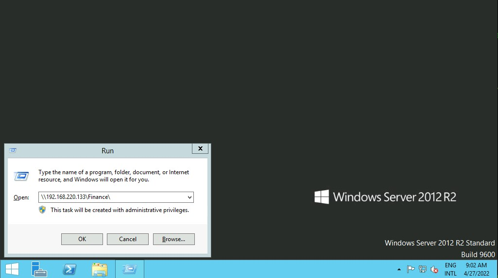
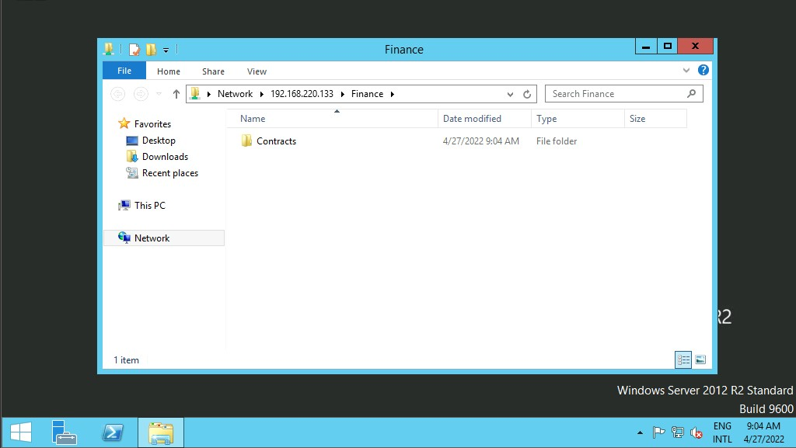
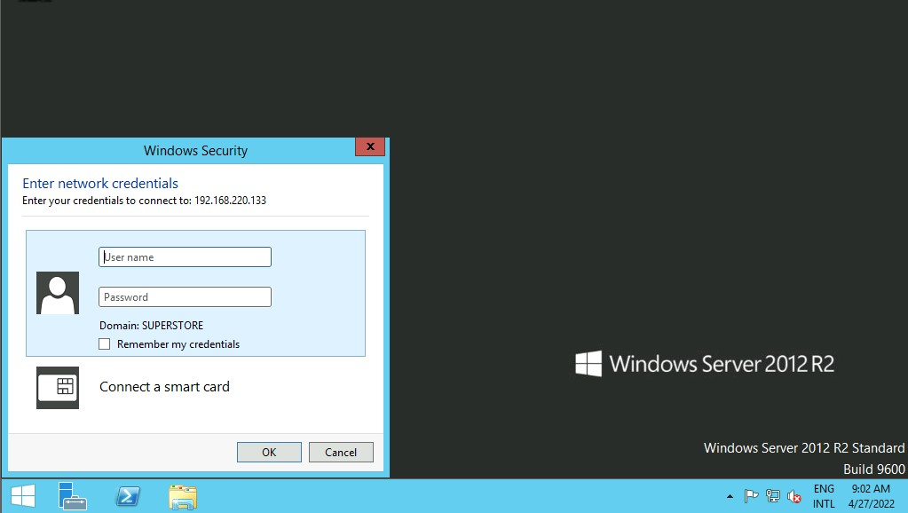

# Tương tác với các Dịch vụ Phổ biến — Tóm tắt

## Tổng quan

Tài liệu này hướng dẫn cách tương tác với các dịch vụ phổ biến trong mạng doanh nghiệp, bao gồm **chia sẻ file**, **email** và **cơ sở dữ liệu**. Để tấn công hoặc kiểm thử bảo mật một dịch vụ, ta cần hiểu mục đích, cách tương tác, công cụ sử dụng và những gì có thể khai thác từ dịch vụ đó.

---

## 1. Dịch vụ Chia sẻ File

Dịch vụ chia sẻ file cung cấp, trung gian và giám sát việc truyền tải file. Các dịch vụ nội bộ phổ biến gồm: **SMB, NFS, FTP, TFTP, SFTP**. Bên cạnh đó, doanh nghiệp hiện nay còn sử dụng dịch vụ đám mây như Dropbox, Google Drive, OneDrive, SharePoint, AWS S3, Azure Blob Storage, Google Cloud Storage.

### 1.1. SMB (Server Message Block)

SMB thường được sử dụng trong mạng Windows để chia sẻ thư mục.

#### Trên Windows

- **Giao diện đồ họa (GUI):** Nhấn `Win + R`, nhập đường dẫn mạng (ví dụ: `\\192.168.220.129\Finance\`).  



- Nếu thư mục cho phép truy cập ẩn danh hoặc ta đã xác thực, nội dung sẽ hiển thị trực tiếp.



- Nếu không, hệ thống sẽ yêu cầu nhập thông tin đăng nhập.



- **Command Prompt (CMD):**
  - `dir \\IP\Share\` — liệt kê nội dung thư mục chia sẻ.
  - `net use n: \\IP\Share\ /user:username password` — map thư mục chia sẻ thành ổ đĩa mạng.
  - `dir n: /a-d /s /b | find /c ":\"` — đếm tổng số file trong thư mục và thư mục con.
  - `dir n:\*cred* /s /b` — tìm file có tên chứa từ khóa cụ thể.
  - `findstr /s /i cred n:\*.*` — tìm kiếm nội dung chứa từ khóa trong tất cả file.

- **PowerShell:**
  - `Get-ChildItem \\IP\Share\` — liệt kê nội dung.
  - `New-PSDrive -Name "N" -Root "\\IP\Share" -PSProvider "FileSystem"` — map ổ đĩa mạng.
  - Sử dụng `PSCredential` object để xác thực với username/password.
  - `Get-ChildItem -Recurse -Path N:\ -Include *cred* -File` — tìm file theo tên.
  - `Get-ChildItem -Recurse -Path N:\ | Select-String "cred" -List` — tìm nội dung trong file (tương tự `grep`).

#### Trên Linux

- **Mount thư mục SMB:**
  ```bash
  sudo mkdir /mnt/Finance
  sudo mount -t cifs -o username=plaintext,password=Password123,domain=. //192.168.220.129/Finance /mnt/Finance
  ```
  Hoặc dùng credential file với cấu trúc: `username=`, `password=`, `domain=`.

  > Cần cài đặt gói `cifs-utils` (`sudo apt install cifs-utils`).

- **Tìm kiếm file và nội dung:**
  - `find /mnt/Finance/ -name *cred*` — tìm file theo tên.
  - `grep -rn /mnt/Finance/ -ie cred` — tìm nội dung chứa từ khóa.

### 1.2. Các dịch vụ khác

FTP, TFTP, NFS cũng có thể được mount tương tự. Sau khi mount, ta sử dụng các công cụ dòng lệnh có sẵn trên Linux/Windows để thao tác với file.

---

## 2. Email

Gửi và nhận email sử dụng hai giao thức chính:

- **SMTP** — gửi email.
- **POP3 / IMAP** — nhận email.

**Công cụ:** Có thể dùng ứng dụng mail client như **Evolution** (trên GNOME Linux) để kết nối tới máy chủ email qua IMAP/SMTP. Cài đặt:

```bash
sudo apt-get install evolution
```

Khi cấu hình, cần cung cấp tên miền hoặc IP của máy chủ mail, và chọn phương thức mã hóa phù hợp (TLS hoặc STARTTLS).

---

## 3. Cơ sở Dữ liệu

Tài liệu tập trung vào hai hệ quản trị CSDL quan hệ phổ biến: **MySQL** và **MSSQL**.

Ba cách tương tác chính:

1. **Công cụ dòng lệnh** (CLI)
2. **Ngôn ngữ lập trình**
3. **Ứng dụng GUI**

### 3.1. Dòng lệnh

| Hệ CSDL | Linux | Windows |
|----------|-------|---------|
| MSSQL | `sqsh -S IP -U user -P pass` | `sqlcmd -S IP -U user -P pass` |
| MySQL | `mysql -u user -pPass -h IP` | `mysql.exe -u user -pPass -h IP` |

### 3.2. Ứng dụng GUI

- **MySQL Workbench** — dành cho MySQL.
- **SQL Server Management Studio (SSMS)** — dành cho MSSQL (chỉ Windows).
- **DBeaver** — đa nền tảng (Linux, macOS, Windows), hỗ trợ nhiều loại CSDL (MSSQL, MySQL, PostgreSQL...).

Cài đặt DBeaver trên Linux:
```bash
sudo dpkg -i dbeaver-<version>.deb
dbeaver &
```

Sau khi kết nối, có thể dùng các câu lệnh Transact-SQL để liệt kê cơ sở dữ liệu, bảng chứa thông tin nhạy cảm (username, password), và nếu có đủ quyền, có thể thực thi lệnh với tư cách tài khoản dịch vụ MSSQL.

---

## 4. Tổng hợp Công cụ

| SMB | FTP | Email | Cơ sở dữ liệu |
|-----|-----|-------|----------------|
| smbclient | ftp | Thunderbird | mssql-cli |
| CrackMapExec | lftp | Claws | mycli |
| SMBMap | ncftp | Geary | mssqlclient.py |
| Impacket | filezilla | MailSpring | dbeaver |
| psexec.py | crossftp | mutt | MySQL Workbench |
| smbexec.py | | mailutils | SSMS |
| | | sendEmail / swaks / sendmail | |

---

## 5. Xử lý Sự cố Chung

Một số lý do phổ biến khiến không thể truy cập dịch vụ:

- **Xác thực** — sai thông tin đăng nhập.
- **Quyền hạn** — tài khoản không đủ quyền truy cập tài nguyên.
- **Kết nối mạng** — máy mục tiêu không thể truy cập được.
- **Tường lửa** — cổng hoặc giao thức bị chặn.
- **Hỗ trợ giao thức** — phiên bản giao thức không tương thích.

> Sử dụng mã lỗi để tra cứu tài liệu chính thức hoặc diễn đàn cộng đồng nhằm tìm hướng giải quyết.