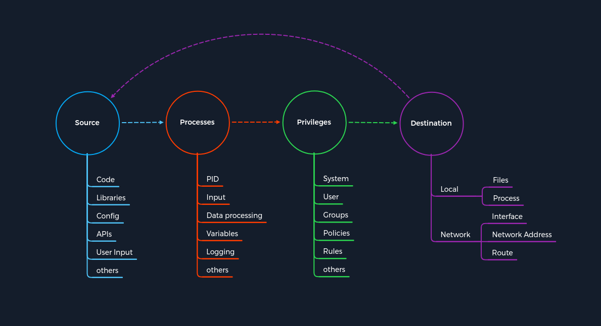

# Lỗ hổng FTP mới nhất (Latest FTP Vulnerabilities) — Tóm tắt

## Tổng quan

Tài liệu phân tích lỗ hổng **CoreFTP trước bản build 727** (CVE-2022-22836). Đây là lỗ hổng trong dịch vụ FTP không xử lý đúng HTTP PUT request, dẫn đến **directory/path traversal** và **ghi file tùy ý** (arbitrary file write) sau khi xác thực. Kẻ tấn công có thể ghi file ra ngoài thư mục mà dịch vụ được phép truy cập.

---

## Cơ chế tấn công

Dịch vụ CoreFTP sử dụng HTTP POST để upload file, nhưng cũng cho phép **HTTP PUT** — có thể bị lợi dụng để ghi nội dung vào file. Exploit rất đơn giản, chỉ cần một lệnh cURL:

```bash
curl -k -X PUT -H "Host: <IP>" --basic -u <username>:<password> \
  --data-binary "PoC." --path-as-is https://<IP>/../../../../../../whoops
```



| Tham số | Mục đích |
|---------|----------|
| `-X PUT` | Gửi HTTP PUT request thay vì POST |
| `--basic -u user:pass` | Xác thực Basic Auth |
| `--data-binary "PoC."` | Nội dung ghi vào file |
| `--path-as-is https://<IP>/../../../../../../whoops` | Đường dẫn chứa ký tự thoát để vượt ra ngoài thư mục giới hạn |
| `-H "Host: <IP>"` | Header chỉ định IP mục tiêu |

---

## Phân tích theo mô hình tấn công (Concept of Attacks)

### Giai đoạn 1 — Directory Traversal (Vượt thư mục)

| Bước | Hành động | Thành phần |
|------|-----------|------------|
| 1 | Người dùng chỉ định loại HTTP request kèm nội dung file và ký tự thoát (`../../../../`) để vượt ra khỏi vùng giới hạn. | **Source** |
| 2 | Tiến trình tiếp nhận và xử lý loại request đã thay đổi, nội dung file và đường dẫn. | **Process** |
| 3 | Ứng dụng kiểm tra quyền truy cập đường dẫn, nhưng vì giới hạn chỉ áp dụng cho một thư mục cụ thể, khi vượt ra ngoài thư mục đó bằng directory traversal, mọi ràng buộc bị bỏ qua. | **Privileges** |
| 4 | Đích đến là tiến trình ghi nội dung do người dùng chỉ định lên hệ thống cục bộ. | **Destination** |

### Giai đoạn 2 — Arbitrary File Write (Ghi file tùy ý)

| Bước | Hành động | Thành phần |
|------|-----------|------------|
| 5 | Thông tin đầu vào được tái sử dụng: tên file (`whoops`) và nội dung (`"PoC."`). | **Source** |
| 6 | Tiến trình xử lý thông tin và tiến hành ghi nội dung vào file được chỉ định. | **Process** |
| 7 | Do mọi ràng buộc đã bị vượt qua ở giai đoạn trước, dịch vụ chấp thuận việc ghi file. | **Privileges** |
| 8 | File `whoops` với nội dung `"PoC."` được tạo trên hệ thống mục tiêu. | **Destination** |

### Kết quả trên hệ thống mục tiêu

```cmd
C:\> type C:\whoops
PoC.
```

---

## Điểm mấu chốt

- **Nguyên nhân gốc:** Tiến trình diễn giải sai đường dẫn do người dùng nhập, không kiểm soát đúng quyền ghi của HTTP PUT request.
- **Hậu quả:** Kẻ tấn công sau khi xác thực có thể ghi file bất kỳ vào bất kỳ vị trí nào trên hệ thống, vượt ngoài thư mục được phép.
- **Mô hình áp dụng:** Lỗ hổng minh họa hoàn hảo chu trình **Source → Process → Privileges → Destination** lặp lại hai lần (vượt thư mục rồi ghi file).