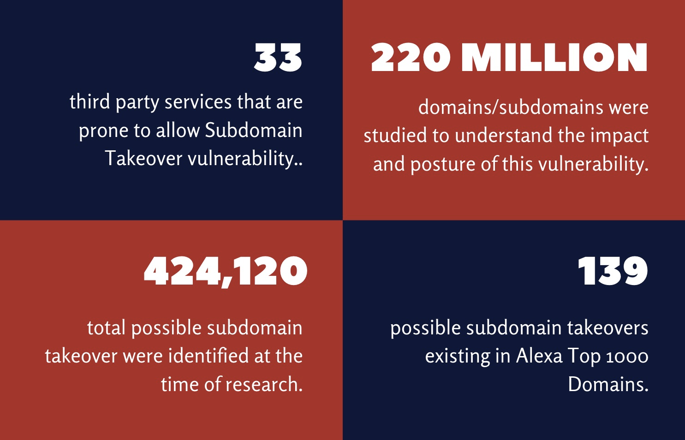

# Lỗ hổng DNS mới nhất (Latest DNS Vulnerabilities) — Tóm tắt

## Tổng quan

Hàng ngàn subdomain và domain trên web trỏ đến các nhà cung cấp dịch vụ bên thứ ba (AWS, GitHub...) đã **ngừng hoạt động**, thường chỉ hiển thị thông báo lỗi. Các công ty lớn thường hủy dịch vụ bên thứ ba nhưng **quên xóa bản ghi DNS** liên quan vì không phát sinh thêm chi phí.

### Thống kê (RedHuntLabs, 2020)

- **220 triệu** domain được nghiên cứu
- **424.120** subdomain có thể bị takeover
- **62%** thuộc lĩnh vực thương mại điện tử
- **139** subdomain nằm trong Alexa Top 1000
- **33** dịch vụ bên thứ ba dễ bị khai thác

Nhiều nền tảng bug bounty (như HackerOne) đã liệt kê **Subdomain Takeover** là danh mục riêng với phần thưởng đáng kể.

---

## Mối nguy hiểm lớn nhất

Subdomain takeover cho phép kẻ tấn công:

- **Phishing** — tạo trang giả mạo trên subdomain thuộc domain chính thức của công ty (ví dụ: `customer-drive.inlanefreight.com`). Khách hàng nhìn thấy URL nằm dưới domain chính thức nên tin tưởng và đăng nhập → bị đánh cắp credential.
- **Đánh cắp cookie**
- **Cross-Site Request Forgery (CSRF)**
- **Lạm dụng CORS**
- **Vượt qua Content Security Policy (CSP)**

---

## Cơ chế tấn công

### Điều kiện

1. Bản ghi **CNAME** trong DNS của công ty trỏ đến subdomain **không còn tồn tại** trên dịch vụ bên thứ ba.
2. Truy cập subdomain đó trả về **HTTP 404**.
3. Kẻ tấn công **đăng ký domain/subdomain** đó trên nhà cung cấp bên thứ ba.
4. Bản ghi CNAME vẫn còn → subdomain tự động trỏ đến server của kẻ tấn công.

---

## Phân tích theo mô hình tấn công (Concept of Attacks)

### Giai đoạn 1 — Chiếm Subdomain

| Bước | Hành động | Thành phần |
|------|-----------|------------|
| 1 | Nguồn là tên subdomain không còn được công ty sử dụng, do kẻ tấn công phát hiện. | **Source** |
| 2 | Đăng ký subdomain này trên trang nhà cung cấp bên thứ ba, liên kết đến tài nguyên của kẻ tấn công. | **Process** |
| 3 | Quyền nằm ở chủ sở hữu domain chính và các mục trong DNS server. Nhà cung cấp bên thứ ba thường không chịu trách nhiệm kiểm tra ai truy cập subdomain. | **Privileges** |
| 4 | Đăng ký và liên kết thành công trên server của kẻ tấn công — đây là đích đến. | **Destination** |

### Giai đoạn 2 — Kích hoạt Chuyển hướng

| Bước | Hành động | Thành phần |
|------|-----------|------------|
| 5 | Khách truy cập nhập URL subdomain vào trình duyệt. Bản ghi CNAME cũ chưa bị xóa được dùng làm nguồn. | **Source** |
| 6 | DNS server tra cứu danh sách và tìm thấy subdomain → chuyển hướng người dùng đến subdomain (do kẻ tấn công kiểm soát). | **Process** |
| 7 | Quyền quản lý domain thuộc về admin quản trị DNS. Vì subdomain có trong danh sách, DNS server coi nó là đáng tin và chuyển tiếp. | **Privileges** |
| 8 | Đích đến là người truy cập yêu cầu địa chỉ IP của subdomain qua mạng để được chuyển hướng. | **Destination** |

---

## Điểm mấu chốt

| Khía cạnh | Chi tiết |
|-----------|----------|
| **Nguyên nhân gốc** | Bản ghi CNAME cũ không được xóa sau khi hủy dịch vụ bên thứ ba |
| **Điều kiện khai thác** | Subdomain trỏ CNAME đến domain không tồn tại + trả về HTTP 404 |
| **Không cần xác thực** | Bất kỳ ai đều có thể đăng ký domain đã hết hạn |
| **Hậu quả** | Phishing, đánh cắp cookie, CSRF, lạm dụng CORS, vượt CSP |
| **Phòng chống** | Xóa bản ghi DNS ngay khi hủy dịch vụ bên thứ ba; kiểm tra định kỳ các bản ghi CNAME |
| **Bug bounty** | Được nhiều nền tảng (HackerOne) công nhận là danh mục riêng với phần thưởng lớn |